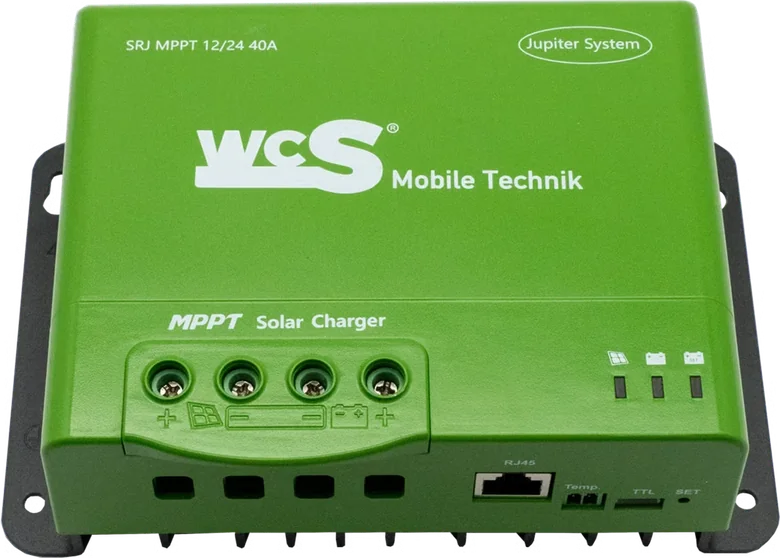

# MPPT Solar Card

Lovelace-Karte für Home Assistant, die die aktuellen Leistungsdaten eines
MPPT-Solarladereglers (z. B. WCS SRJ MPPT 12/24 40A „Jupiter System“) anzeigt:

| Wert | Konfigurationsschlüssel |
|---|---|
| Leistung Solarpanel | `pv_power` (optional – fehlt er, wird U × I berechnet) |
| Spannung Solarpanel | `pv_voltage` |
| Strom Solarpanel | `pv_current` |
| Strom Richtung Batterie | `battery_current` |
| Temperatur Laderegler | `temperature` |

Dazu gibt es ein Produktbild des Reglers, eine animierte Energiefluss-Anzeige
(Solar → Laderegler → Batterie, Geschwindigkeit abhängig von Leistung bzw.
Ladestrom) und eine farbige Temperaturwarnung.



## Installation über HACS

1. HACS öffnen → Menü (⋮) → **Benutzerdefinierte Repositories**.
2. URL dieses Repositorys eintragen, Typ **Dashboard** (früher „Lovelace“) wählen.
3. „MPPT Solar Card“ suchen und herunterladen.
4. Browser neu laden (Cache leeren).

HACS legt die Ressource `/hacsfiles/mppt-solar-card/mppt-solar-card.js`
automatisch an.

### Manuell

`dist/mppt-solar-card.js` nach `/config/www/` kopieren und unter
*Einstellungen → Dashboards → Ressourcen* als JavaScript-Modul
`/local/mppt-solar-card.js` hinzufügen.

## Konfiguration

Die Karte lässt sich komplett im grafischen Editor einrichten
(„Karte hinzufügen“ → „MPPT Solar Card“). Als YAML:

```yaml
type: custom:mppt-solar-card
name: MPPT Laderegler
pv_power: sensor.mppt_pv_leistung
pv_voltage: sensor.mppt_pv_spannung
pv_current: sensor.mppt_pv_strom
battery_current: sensor.mppt_ladestrom
temperature: sensor.mppt_temperatur
```

### Alle Optionen

| Option | Typ | Standard | Beschreibung |
|---|---|---|---|
| `name` | string | `MPPT Solar Charger` | Titel; leer = kein Kopfbereich |
| `pv_power` | entity | – | Leistung Solarpanel (W). Ohne Angabe: `pv_voltage × pv_current` |
| `pv_voltage` | entity | – | Spannung Solarpanel (V) |
| `pv_current` | entity | – | Strom Solarpanel (A) |
| `battery_current` | entity | – | Ladestrom zur Batterie (A); negative Werte = Entladung |
| `temperature` | entity | – | Temperatur des Ladereglers |
| `temp_warning` | number | `50` | Ab dieser Temperatur orange |
| `temp_critical` | number | `65` | Ab dieser Temperatur rot |
| `max_power` | number | `500` | Solarleistung, bei der die Fluss-Animation am schnellsten läuft |
| `max_current` | number | `40` | Ladestrom, bei dem die Fluss-Animation am schnellsten läuft |
| `show_image` | boolean | `true` | Produktbild anzeigen |
| `show_flow` | boolean | `true` | Energiefluss anzeigen |
| `image` | string | eingebautes Bild | Eigene Bild-URL, z. B. `/local/mein-regler.png` |

Nicht konfigurierte Werte werden ausgeblendet; nicht verfügbare Sensoren
erscheinen als „—“. Ein Klick auf einen Wert öffnet den Verlauf der Entität.
Die Nachkommastellen folgen der in Home Assistant eingestellten Anzeigegenauigkeit.

## Woher kommen die Sensoren?

Die Karte zeigt nur vorhandene Home-Assistant-Sensoren an. Der Regler hat
eine RJ45-Kommunikationsschnittstelle und einen TTL-Port; die Werte lassen
sich je nach Protokoll z. B. über die Modbus-Integration oder einen
ESP32 mit ESPHome als Sensoren in Home Assistant einbinden.

## Entwicklung

```bash
npm run build   # erzeugt dist/mppt-solar-card.js (Version + eingebettetes Bild)
```

Quellcode liegt in `src/`, das Bild in `images/`. Für ein Release einen
GitHub-Release mit Tag `vX.Y.Z` anlegen – der Workflow baut die Datei und
hängt sie an. HACS bietet dann diese Version zur Installation an.
